<p align="center">
  
</p>

# Awesome Continuous Fine-Tuning Pipelines 🚀

<p align="center">
  <a href="https://github.com/ishandutta2007/Awesome-Awesome-Awesome"></a><a href="https://discord.gg/jc4xtF58Ve"></a>
  <a href="https://github.com/ishandutta2007/Awesome-Continuous-Fine-Tuning-Pipelines/stargazers"></a>
  <a href="https://github.com/ishandutta2007/Awesome-Continuous-Fine-Tuning-Pipelines/network/members"></a>
  <a href="https://github.com/ishandutta2007/Awesome-Continuous-Fine-Tuning-Pipelines/issues"></a>
  <a href="https://github.com/ishandutta2007/Awesome-Continuous-Fine-Tuning-Pipelines/blob/main/LICENSE"></a>
  <a href="https://github.com/ishandutta2007"></a>
</p>

## 🌐 The Continuous Fine-Tuning & Automated Model Retraining Ecosystem

> **A curated collection of production-grade SaaS platforms, open-source frameworks, low-overhead PEFT/LoRA tools, automated retraining pipelines, and evaluation gates.**

Welcome to the definitive, SEO-optimized knowledge base for **Continuous Fine-Tuning Pipelines**, **Automated LLM Retraining**, **Post-Training Alignment**, and **Domain-Specific Model Refresh**. Whether you are adapting 7B/70B LLMs to evolving corporate documentation, refreshing SLMs on real-time customer support logs, or automating recurrent LoRA checkpoints with evaluation gates, this guide catalogs both state-of-the-art managed platforms and battle-tested open-source repositories.

---

## 📑 Table of Contents

- [📊 Sector Overview & Market Dynamics](#-sector-overview--market-dynamics)
- [☁️ SaaS & Hosted Platforms](#️-saas--hosted-platforms)
- [💻 Open-Source GitHub Projects](#-open-source-github-projects)
- [🛠️ Architectural Blueprint: Building a Continuous Pipeline](#️-architectural-blueprint-building-a-continuous-pipeline)
- [🤝 How to Contribute](#-how-to-contribute)
- [💖 Support & Sponsorship](#-support--sponsorship)
- [📈 Star History](#-star-history)
- [⚠️ Disclaimer](#️-disclaimer)

---

## 📊 Sector Overview & Market Dynamics

The global market for **Large Language Model (LLM) fine-tuning, domain adaptation, and AI training data engineering** is estimated at **$5.9B–$7.4B in 2025** and projected to surge past **$7.6B–$9.8B in 2026** (representing a ~30%+ CAGR). As off-the-shelf foundation models commoditize, enterprise competitive advantage has shifted to continuous adaptation on proprietary corpora.

The competitive landscape is **moderately fragmented and evolving into a bifurcated structure**:
1. **Hyperscale Cloud Ecosystems (AWS SageMaker, Azure AI Foundry):** Capture large-scale corporate enterprise spending where compliance, single-pane billing, and extensive data governance outweigh raw token agility.
2. **Specialized Independent AI Infrastructure (Fireworks AI, Together AI, Baseten):** Capture rapid developer and AI-native adoption through low-latency serving, granular LoRA/PEFT pipelines, dedicated multi-tenant adapter multiplexing, and significantly lower cost-per-token economics.

Rather than a single "winner-take-all" outcome, the domain favors interoperability: teams routinely orchestrate open-source training runners (Unsloth, Axolotl, LLaMA-Factory) on top of specialized serverless compute.

---

## ☁️ SaaS & Hosted Platforms

Managed platforms that streamline data ingestion, automated distributed training, hyperparameter sweeps, adapter storage, and autoscaled inference endpoints.

| Platform | Company Size (Valuation / Revenue) | Pricing (Starting Tier / Rates) | Free Tier / Trial Limits | Key Focus & Production Capabilities |
| :--- | :--- | :--- | :--- | :--- |
| **[Azure AI Foundry](https://azure.microsoft.com/en-us/products/ai-foundry)** | **~$4.0 Trillion** market cap (Microsoft) | Pay-as-you-go; fine-tuning compute from ~$1.70/hr deployment hosting + token rates ($0.50+/1M tokens) | **30-day free trial with $200 credits**; fine-tuning requires moving past restricted trial quotas to standard PAYG | Enterprise compliance, Azure OpenAI customization, and centralized multi-model deployment |
| **[AWS SageMaker](https://aws.amazon.com/sagemaker/)** | **~$2.8 Trillion** parent cap (~$169B ARR / $1T+ implied valuation) | Pay-as-you-go; training from $0.50/1M tokens (SFT) or $0.70/hr (ml.g5.xlarge GPU compute) | **2-month free tier**: 250 hrs ml.t3.medium notebook, 50 hrs ml.m5.xlarge CPU training, 125 hrs inference (GPUs not included in free tier) | Fully managed ML pipelines, SageMaker JumpStart, and automated distributed training |
| **[Fireworks AI](https://fireworks.ai/)** | **~$17.5 Billion** valuation (Series D) / $1B+ ARR | LoRA SFT: **$0.50 / 1M tokens** (<16B models) up to $10.00 / 1M tokens (>300B); Full param SFT: $1.00 / 1M tokens | **$1 one-time sign-up credit** for serverless inference/testing; no permanent free tier | Ultra-fast inference engine, automated LoRA/DPO tuning, and structured JSON generation |
| **[Baseten](https://baseten.co/)** | **~$13.0 Billion** valuation (Series F) / ~$600M ARR | Pay-as-you-go ($0/mo platform fee); GPU instances from **$0.30/hr** (T4) and dedicated deployments billed per minute | **$30 free credits** upon workspace registration; up to $25k via Startup Program | High-throughput Truss model packaging, cold-start mitigation, and autoscaling endpoints |
| **[Together AI](https://www.together.ai/)** | **~$8.3 Billion** valuation (Series C) / $1B+ ARR | Fine-tuning starts at **$0.48 / 1M tokens** (scales by model size/method) + dedicated hosting rates; min $15 initial deposit | **$5–$25 promotional signup credits** (varies by promotion); no permanent free tier | Managed full and LoRA adaptation for leading open models (Llama, Mistral, Qwen) |
| **[Snorkel AI](https://snorkel.ai/)** | **~$3.5 Billion** valuation (Series E) / ~$375M ARR | Enterprise contracts starting at **~$50,000–$60,000/year** (via AWS Marketplace / direct sales) | **60-day enterprise Proof-of-Concept (POV)** or complimentary custom LLM evaluation report; no self-serve free tier | Programmatic data curation, weak supervision labeling, and continuous dataset versioning |
| **[Anyscale](https://www.anyscale.com/)** | **~$1.65 Billion** acquisition value (by Nscale) | Compute-hour billing from **$0.0135/hr (CPU)** and **$0.5682/hr (T4 GPU)** to $4.9591/hr (A100) | **$100 free compute credits** on registration; sample fine-tuning templates start at ~$3–$5 in compute | Managed Ray platform (Ray Train & Ray Tune) for elastic multi-node distributed training |
| **[OctoAI](https://octoai.cloud/)** | **~$900 Million** peak valuation (Acquired by Nvidia) | Formerly compute-based / $0.05+/1M tokens; standalone APIs integrated into **NVIDIA NIM** | Standalone cloud service sunsetted; **free prototyping access available via build.nvidia.com** (NVIDIA NIM) | Deeply optimized inference runtimes and model adaptation, now embedded in NVIDIA NIM |
| **[Predibase](https://predibase.com/)** | **~$100M–$250M** valuation (Acquired by Rubrik) | Pay-as-you-go / custom VPC contract; multi-tenant LoRA serving from fractional GPU compute rates | **$25 free platform credits** for developer testing; proof-of-concept trial via sales/AWS marketplace | LoRAX dynamic multi-LoRA serving framework and declarative managed tuning pipelines |
| **[Lamini](https://lamini.ai/)** | **~$150 Million** valuation (Series A) | **$1.00 per tuning step per GPU**; inference at $0.50 / 1M tokens | **$300 free credits** upon new account creation; refills in $100 increments | Memory Tuning for factual recall, proprietary data adaptation, and strict VPC privacy |

---

## 💻 Open-Source GitHub Projects

The leading open-source repositories powering autonomous, self-hosted continuous fine-tuning pipelines. **Sorted by GitHub Stars in descending order.**

1. ### **[vLLM](https://github.com/vllm-project/vllm)** [](https://github.com/vllm-project/vllm/stargazers)
   - **High-throughput, memory-efficient serving engine supporting dynamic multi-LoRA adapter swapping.**
   - While primarily recognized as the premier serving runtime with PagedAttention, vLLM's dynamic LoRA loading allows a single production instance to serve dozens of continuously updated, domain-specific adapters over a shared base model without downtime.

2. ### **[Unsloth](https://github.com/unslothai/unsloth)** [](https://github.com/unslothai/unsloth/stargazers)
   - **The fastest open-source fine-tuning engine for single-GPU environments.**
   - Hand-crafted OpenAI Triton kernels deliver **2×–5× faster training with 40%–70% less VRAM consumption** compared to standard Hugging Face implementations. Seamlessly supports QLoRA, LoRA, Full Fine-Tuning, and Reinforcement Learning (GRPO, DPO). Allows training Llama 3.1 8B on consumer GPUs (e.g. RTX 3060 12GB). Includes native integration with Hugging Face TRL and Trainer.

3. ### **[LLaMA-Factory](https://github.com/hiyouga/LLaMA-Factory)** [](https://github.com/hiyouga/LLaMA-Factory/stargazers)
   - **Comprehensive, unified web dashboard and CLI framework for 100+ LLMs & VLMs.**
   - Supports continuous pre-training, SFT, reward modeling, PPO, DPO, KTO, and ORPO. Incorporates advanced optimization techniques including GaLore, BAdam, APOLLO, DoRA, LongLoRA, and PiSSA. Features a zero-code Web UI (LLaMA Board) for experiment tracking alongside robust programmatic APIs.

4. ### **[DeepSpeed](https://github.com/microsoft/DeepSpeed)** [](https://github.com/microsoft/DeepSpeed/stargazers)
   - **Microsoft's extreme-scale distributed optimization and training library.**
   - Powers large-scale continuous fine-tuning through ZeRO (Zero Redundancy Optimizer Stages 1, 2, and 3), ZeRO-Offload, 3D parallelism, and mixed-precision acceleration. The industry gold standard for multi-node, cluster-scale model refresh.

5. ### **[Stanford Alpaca](https://github.com/tatsu-lab/stanford_alpaca)** [](https://github.com/tatsu-lab/stanford_alpaca/stargazers)
   - **The seminal instruction-following dataset and fine-tuning recipe.**
   - Laid the foundational blueprint for instruction-tuning open models, generating synthetic alignment datasets, and executing parameter-efficient adaptation routines.

6. ### **[PEFT](https://github.com/huggingface/peft)** [](https://github.com/huggingface/peft/stargazers)
   - **Hugging Face's official Parameter-Efficient Fine-Tuning library.**
   - The foundational adapter engine providing modular implementations of LoRA, Prefix Tuning, P-Tuning, Prompt Tuning, AdaLoRA, BOFT, and QLoRA. Integrates directly with Transformers, Accelerate, and TRL.

7. ### **[Hugging Face TRL](https://github.com/huggingface/trl)** [](https://github.com/huggingface/trl/stargazers)
   - **Transformer Reinforcement Learning toolkit for end-to-end post-training alignment.**
   - Offers high-level abstractions (`SFTTrainer`, `DPOTrainer`, `GRPOTrainer`, `RewardTrainer`) designed to take base models through supervised adaptation and preference optimization in production pipelines.

8. ### **[Axolotl](https://github.com/axolotl-ai-cloud/axolotl)** [](https://github.com/axolotl-ai-cloud/axolotl/stargazers)
   - **Declarative, YAML-driven fine-tuning framework for reproducible production MLOps.**
   - Allows defining model architectures, dataset paths, LoRA hyperparameters, and training regimes within a single version-controlled configuration file. Supports sequence parallelism, GaLore memory reduction, multi-GPU scaling (DeepSpeed/FSDP), and automated validation routines.

9. ### **[MOSS](https://github.com/OpenLMLab/MOSS)** [](https://github.com/OpenLMLab/MOSS/stargazers)
   - **Conversational foundation model and tool-augmented training framework.**
   - Comprehensive system demonstrating dialog-driven fine-tuning, plugin integration, and alignment workflows.

10. ### **[MLX Examples](https://github.com/ml-explore/mlx-examples)** [](https://github.com/ml-explore/mlx-examples/stargazers)
    - **Native Apple Silicon machine learning framework and fine-tuning examples.**
    - High-performance, low-latency fine-tuning leveraging unified Apple Silicon memory architectures without CUDA dependencies.

11. ### **[Snorkel](https://github.com/snorkel-team/snorkel)** [](https://github.com/snorkel-team/snorkel/stargazers)
    - **Programmatic training data creation system powered by weak supervision.**
    - Programmatic labeling functions, generative label models, data slicing, and transformation routines. Essential when continuous retraining requires automated annotation of newly incoming unstructured text.

12. ### **[torchtune](https://github.com/pytorch/torchtune)** [](https://github.com/pytorch/torchtune/stargazers)
    - **PyTorch-native library for easily authoring, fine-tuning, and experimenting with LLMs.**
    - Clean, hackable, modular PyTorch components without layers of obscure abstractions; built-in memory-efficient recipes, distributed training hooks, and quantization support.

13. ### **[XTuner](https://github.com/InternLM/xtuner)** [](https://github.com/InternLM/xtuner/stargazers)
    - **Lightweight, flexible toolkit for fine-tuning LLMs and multimodal agents.**
    - Adaptable to 8GB consumer GPUs with QLoRA; supports FlashAttention, DeepSpeed, and long-context training across diverse open-weights families.

14. ### **[LoRAX](https://github.com/predibase/lorax)** [](https://github.com/predibase/lorax/stargazers)
    - **Multi-LoRA serving runtime designed to host hundreds of fine-tuned adapters on a single GPU.**
    - Solves the economic challenge of continuous fine-tuning by dynamically loading adapter weights per request onto a shared foundational backbone.

15. ### **[mlx-commander](https://pypi.org/project/mlx-commander/)**
    - **Apple Silicon fine-tuning orchestrator with Model Context Protocol (MCP) server support.**
    - Features 8 MCP tools that enable AI agents to autonomously evaluate training data, verify VRAM feasibility, queue hyperparameter sweeps, and trigger local training runs.

---

## 🛠️ Architectural Blueprint: Building a Continuous Pipeline

A robust, enterprise-grade continuous fine-tuning pipeline requires five interconnected stages:

```
┌─────────────────┐     ┌──────────────────┐     ┌──────────────────┐
│  Data Ingestion │ ──> │   Auto-Labeling  │ ──> │ Fine-Tuning Exec │
│  & Deduplication│     │  (Snorkel / LLM) │     │(Unsloth/Axolotl) │
└─────────────────┘     └──────────────────┘     └──────────────────┘
                                                           │
                                                           ▼
┌─────────────────┐     ┌──────────────────┐     ┌──────────────────┐
│ Production Host │ <── │ Deployment Gate  │ <── │ Evaluation Suite │
│ (vLLM / LoRAX)  │     │(Canary / Shadow) │     │ (DeepEval/Ragas) │
└─────────────────┘     └──────────────────┘     └──────────────────┘
```

1. **Continuous Data Ingestion**: Monitor object stores, vector DBs, and database tables for newly validated domain content.
2. **Programmatic Data Preparation**: Utilize weak supervision ([Snorkel](https://github.com/snorkel-team/snorkel)) or automated LLM judges to filter, clean, and format prompt-completion pairs.
3. **Automated Training Run**: Trigger headless, declarative training via [Unsloth](https://github.com/unslothai/unsloth) or [Axolotl](https://github.com/axolotl-ai-cloud/axolotl) using parameter-efficient methods (LoRA/QLoRA).
4. **Automated Evaluation Gate**: Benchmark candidate checkpoints against a fixed regression test suite to detect catastrophic forgetting and domain drift before promoting.
5. **Zero-Downtime Serving**: Hot-load the newly minted adapter into [vLLM](https://github.com/vllm-project/vllm) or [LoRAX](https://github.com/predibase/lorax) without restarting base infrastructure.

---

## 🤝 How to Contribute

We welcome contributions from the community! To suggest a platform or framework:

1. 🍴 **Fork the repository**
2. 🌿 **Create your branch**: `git checkout -b feature/add-new-tool`
3. 📝 **Add your entry**: Follow the existing format and ensure factual, verifiable details regarding pricing, star metrics, and capabilities.
4. 🚀 **Submit a Pull Request** with a concise summary.

---

## 💖 Support & Sponsorship

If this curated repository saved you time, infrastructure budget, or helped streamline your ML pipeline:

- ⭐ **Star this repository** to help others discover it!
- 🍴 **Fork and share** it with fellow ML engineers and teams.
- ☕ **Support continuous maintenance & open research**: [Sponsor Ishan on GitHub](https://github.com/sponsors/ishandutta2007)

---

## 📈 Star History

[](https://star-history.dera.page/#ishandutta2007/Awesome-Continuous-Fine-Tuning-Pipelines&type=date&legend=top-left)

---

## ⚠️ Disclaimer

- This is a community-curated directory intended for research, engineering, and educational purposes. Inclusion does not constitute a commercial endorsement.
- Continuous fine-tuning pipelines ingesting proprietary enterprise data must adhere to relevant compliance, governance, and privacy frameworks (GDPR, HIPAA, CCPA) and upstream model licenses.
- Hardware speedups (e.g., Unsloth) are specific to supported NVIDIA GPU architectures and CUDA runtime configurations.
- Always implement rigorous evaluation gates prior to automated production deployments to prevent degradation and regression.
